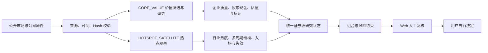

# A 股价值投资与热点跟踪 Agent

一个面向个人投资者的、证据可追溯的 A 股研究与决策辅助系统。

项目希望回答五个实际问题：今天有哪些公司值得研究、为什么值得研究、什么价格条件值得复核、已有持仓为什么继续持有或调整，以及哪些新证据已经改变原来的投资逻辑。

系统包含两条相互独立的研究路径：

- `CORE_VALUE`：从企业经营、财务质量、资本配置、股东现金回报和估值出发，形成价值研究结论。
- `HOTSPOT_SATELLITE`：从行业活跃度、个股结构、多周期价格行为和风险收益出发，形成热点波段观察。

两条路径最终进入统一的研究与风险展示，但不会自动下单。项目永久保持：

```text
action=no_order
```

## 当前状态

这是一个持续开发中的研究产品，不是已经验证有效的自动交易系统。

| 模块 | 当前状态 | 可以说明什么 | 不能说明什么 |
| --- | --- | --- | --- |
| 本地 Web 工作台 | 可运行 | 展示每日观察、公司研究、决策过程、组合、事件和系统状态 | 页面状态不等于投资批准 |
| 价值研究 | `PARTIAL` | 已形成来源绑定的公司研究、Bear/Base/Bull、现金约束与反证 | 条件估值不等于当前合理价或买入价 |
| 600519 纵向案例 | 条件研究已贯通 | 真实原件 → 十年经营/现金路径 → 共享估值 → API/Web | 永久超额盈利尚不足以成为唯一主估值 |
| 热点波段 | `NOT_PROVEN` | 已有行业/个股观察、多周期结构、入场失效和成本约束 | 事后回放不等于严格样本外或真实 Shadow 有效性 |
| 组合与仓位 | 有合同和隔离演练 | 可处理现金、持仓、T+1、集中度和双策略预算 | 没有用户确认的账户与 IPS 时不生成个人数量 |
| 自动交易 | 禁止 | 所有输出只供人工复核 | 不连接券商、不创建订单 |

最新工程证据以 [当前执行台账](docs/current/web-first-full-product-execution-ledger.md) 和 [执行状态](docs/execution-status.md) 为准。文档中的 `PASSED`、测试通过或模型算术完成，都不能单独证明策略有效或实盘就绪。

## 产品流程



系统严格区分：

- `NO_TRADE`：已经评价，当前不满足操作条件。
- `UNASSESSABLE`：关键证据不足，暂时不能评价。
- `CONDITIONAL_MANUAL_REVIEW`：研究与风险条件达到人工复核门槛，并非交易指令。

## 价值策略

价值链路按以下顺序工作：

```text
全市场多通道筛选
→ 可信财务与经营事实
→ Business Quality / Capital Allocation
→ 正常化盈利与股东现金回报
→ 适用估值模型
→ Bear / Base / Bull + Confidence
→ ModelValidity + PriceBridge
→ 买入、加仓、持有、减仓、退出的人工复核理由
```

筛选不是单一低 PE/PB 排名，而是保留质量复利、高股息/现金回报、低估价值和周期价值等不同入口。好公司、便宜股票和适合买入是三个不同判断。

600519 已完成一条真实来源纵向链：年度现金承诺、出资差额及逐年分配进入十年现金约束模型，实际年度留存率进入共享剩余收益模型，并由现有 API/Web 消费。当前形成的 2026-06-30 条件研究区间约为 **791 / 946 / 1004 元/股**。

这些数字不是当前买入价格。中心路径仍依赖终端超额盈利长期持续，有限优势期、维护投入、营运资本、未来资金上划和终端分配均需继续比较，因此该路径被保留为条件研究分支，未被批准为唯一主估值。

相关证据见 [600519 股东现金清单](docs/current/600519-shareholder-cash-evidence-20261026.json)。

## 热点波段策略

热点链路目前覆盖：

```text
行业活跃度
→ 跨行业候选
→ 日线 / 60 分钟 / 15 分钟结构
→ 趋势、突破、回踩、成交量确认
→ 条件入场、保护位、风险收益
→ 加仓、减仓、失效与退出观察
```

规则包含 T+1、手续费、滑点、涨跌停/停牌等可成交性边界，并禁止使用未完成 K 线或未来数据。现有历史证据覆盖仍有限，严格 PIT、独立样本外和自然时间 Shadow 尚未完成，所以当前只输出观察或拒绝，不宣称策略具备稳定超额收益。

规则和证据边界见 [热点策略规范](docs/current/swing-strategy-specification-20261023.md)。

## Web 工作台

Web 是当前主要用户界面，默认使用唯一端口：

```text
http://127.0.0.1:8001/daily
```

主要页面包括：今日、机会、决策过程、公司、我的组合、事件，以及系统/审计页面。Web 只消费后端已经核验的状态，不在浏览器中重新计算财务、估值或交易资格。

Excel 仍作为历史研究、人工记录和兼容展示层保留；当前产品开发以 Web 为先。正式 WPS 工作簿仍遵循单一 canonical workbook 规则，不从候选工作簿切换入口。

## 快速开始

环境要求：

- Windows 与 PowerShell 7
- Python 3.12+
- Node.js（构建 Web 时需要）
- PostgreSQL 仅在运行相应持久化或恢复验证时需要

在项目根目录执行：

```powershell
python -m venv .venv
& .\.venv\Scripts\python.exe -m pip install -e ".[dev,web,strategy-validation]"
npm ci --prefix web
npm run build --prefix web
```

启动本地工作台：

```powershell
pwsh -NoProfile -File scripts/current/start_web_workbench.ps1 -Open
```

启动脚本只使用 `127.0.0.1:8001`。如果端口被未知进程占用，它会拒绝另开端口或停止该进程。私人页面默认锁定；一次性本机授权信息不会写入 Git。

只读核验既有公开快照：

```powershell
pwsh -NoProfile -File scripts/current/run_daily_workbench.ps1 -Mode READ_ONLY -NoServer
```

`READ_ONLY` 不采集网络、不发布、不写回执，也不启动 Web。公开数据刷新必须显式使用受限的 `SAFE_REFRESH`；它仍不能签署经济研究、事件材料性或策略批准。

查看已登记研究：

```powershell
python -X utf8 scripts/current/use_trade_assistant.py --symbol 600519 --details
```

支持的产品与工程命令以 [CLI 注册表](config/current-cli-entrypoints-v2.json) 为准，不要根据脚本文件名或日期猜测入口。

## 测试

后端：

```powershell
python -B -m pytest -q
```

前端：

```powershell
npm run typecheck --prefix web
npm test --prefix web -- --run
npm run build --prefix web
```

GitHub Actions 分开运行 Core Research Gates、Web Workbench 和隔离 PostgreSQL 检查。测试验证合同、重放和 fail-closed 行为；测试通过不代表价值假设正确、热点策略有效或未来盈利。

## 架构

```text
Raw Source / Evidence
        ↓
Validated Facts + Point-in-Time identity
        ↓
Domain research and valuation models
        ↓
Application services and repositories
        ↓
Decision / portfolio read models
        ↓
FastAPI + Web / canonical Excel
```

- `domain/`：投资研究、估值、风险和状态合同，不读取网络、Excel 或数据库。
- `application/`：研究、刷新、复核和产品用例编排。
- `infrastructure/`：公开数据、PDF、数据库、证据和外部服务适配。
- `presentation/`：FastAPI、Web read model 和 Excel 发布。
- `operations/`：生产前检查、Shadow、恢复与运行控制。
- `web/`：React/Umi 用户界面。

完整分层见 [架构合同](docs/architecture.md) 和 [仓库架构](docs/architecture/repository-architecture.md)。

## 数据与证据原则

任何可能影响研究结论的数据都应记录：

- 证券与财务主体；
- 报告期、发布时间和系统可用时间；
- 来源 URL、原始文件 Hash 与版本；
- 事实、计算推导、研究假设和未知项的分类；
- 模型、规则、价格快照及人工复核版本。

原始公告、财报和关键数据优先以交易所、CNINFO 或公司披露为依据。聚合数据可用于发现和交叉检查，但不能静默替代正式证据。今天补取的历史材料不会被冒充为当时已经获得的数据。

详细要求见 [数据与证据政策](docs/data-and-evidence-policy.md)。

## 安全与公开仓库边界

本仓库不应包含：

- `.env`、API Key、数据库口令和 SSH 私钥；
- 个人账户、真实持仓、交易流水或私人 IPS；
- 数据库导出、未脱敏日志及备份密钥；
- 原始公告/PDF 缓存、运行时备份和 Excel 回退副本。

这些资产通过本地私人目录、加密备份和来源绑定清单管理。公开研究可以在没有私人账户时运行；个人仓位与股数必须等用户提供并确认真实输入后计算。

## 文档导航

| 内容 | 入口 |
| --- | --- |
| 产品目标 | [docs/north-star.md](docs/north-star.md) |
| 当前任务 | [docs/current-stage-goal.md](docs/current-stage-goal.md) |
| 当前文档索引 | [docs/current/README.md](docs/current/README.md) |
| 研究方法 | [docs/research-methodology.md](docs/research-methodology.md) |
| 架构合同 | [docs/architecture.md](docs/architecture.md) |
| 数据与证据政策 | [docs/data-and-evidence-policy.md](docs/data-and-evidence-policy.md) |
| 执行状态 | [docs/execution-status.md](docs/execution-status.md) |
| 当前工程台账 | [docs/current/web-first-full-product-execution-ledger.md](docs/current/web-first-full-product-execution-ledger.md) |
| CLI 与工具入口 | [config/current-cli-entrypoints-v2.json](config/current-cli-entrypoints-v2.json) |
| 版本记录 | [CHANGELOG.md](CHANGELOG.md) |

## 免责声明

本项目仅用于研究、软件工程和个人决策辅助，不构成投资建议、收益承诺或受托资产管理服务。所有 BUY / ADD / HOLD / REDUCE / EXIT 类状态都只表示“值得人工复核”，最终投资决定与交易由用户本人完成。
