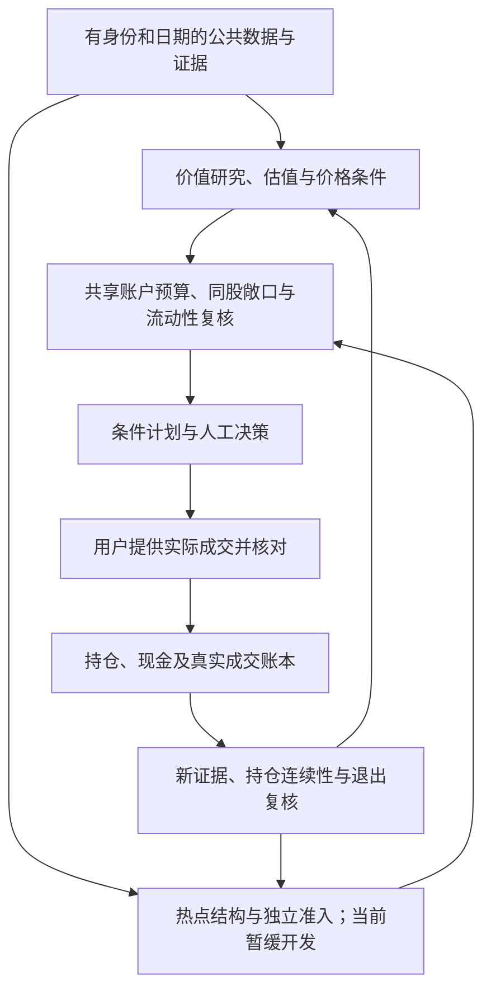

# 架构与进度页：模块交付与验收约定

日期：2026-10-28。适用于既有 Web 的 `ProjectControl` 页面及后续按模块开发的工作记录。路由为 `/project`，导航名称为“架构与进度”；路径登记不代表已经部署。

本页帮助用户看清系统如何工作、哪些环节已有实现、哪一项业务尚未验证，以及下一轮要交付什么。它复用现有 Web、研究、决策、风险与账本合同，不建立新的研究平台、审批平台或投资准入权威。

## 1. 本轮范围与依据

本轮最新用户要求授权增加“架构与进度”支持页面。当前业务重心仍是价值投资闭环；热点保留在整体架构中，继续标明开发暂缓，不因画出流程或登记模块而恢复热点研究。所有研究与复核维持 `action=no_order`。

读文档时按职责使用 [AGENTS.md](../../AGENTS.md)、[当前阶段目标](../current-stage-goal.md) 和 [架构合同](../architecture.md)。较早的 [双策略用户手册](dual-strategy-workbench-user-guide.md) 仍有“Excel 唯一正式前端”“热点依赖价值门”等历史措辞；当前阶段目标中 Web-first、Excel-frozen、热点独立准入的约定，以及本轮明确用户要求控制当前范围。旧段落和历史验收不能被当作重新启动任务的指令。

本次页面初始盘点使用的源码审查基线为 `1e3f6af10e62fc55cf0141e0c91dddee12310aa3`。这只是盘点依据，不代表当前浏览器、后端、部署或后续开发提交已经是这个版本；这些版本须分别显示和核验。旧测试数量、历史运行版本及已保存截图都不能自动转成当前版本的通过证明。

## 2. 一个页面进度数据源

**`web/src/data/projectControl.ts` 是本页唯一的结构化进度数据源。** 模块卡片、流程节点、任务清单、状态统计和证据入口都从它读取。页面组件不再手写第二份模块状态或完成数量。

职责分工如下：

| 载体 | 职责 |
| --- | --- |
| `web/src/data/projectControl.ts` | 当前页面展示的模块、依赖、任务、三轴状态、证据引用与盘点版本。 |
| 本文 | 解释状态含义、更新纪律、交付流程和偏航检查，不维护第二份逐模块进度表。 |
| 既有执行台账与不可变验收材料 | 保存历次实际工作、样本、检查结果及决定；由页面引用，不派生另一套竞争的当前任务队列。 |
| 现有业务 API、研究合同与私人账本 | 继续拥有证券判断、研究准入、真实资金与持仓状态。页面进度不能反向修改这些状态。 |

数据源是可审阅的版本快照，不是自动发现所有代码能力的扫描器，也不是实时生产遥测。应显示盘点日期、来源版本、适用范围和当前开发焦点。未接业务 API 的进度信息要直说“人工维护的项目进度快照”，不能装成运行系统刚刚验证的结果。

每个模块至少能回答：模块标识和职责、所属策略或共享层、输入与输出、上游依赖、已有代码入口、可见产品路径、三轴状态、证据、具体缺口、下一项可执行任务。字段可复用数据文件已有类型；不能用自由文本“完成”代替有定义的状态。

统计只从相同口径的数据集合计算；明确分母，区分暂缓、未开始、部分实现和已实现。不要把三个轴平均成一个“总完成率”，也不要把画出的目标节点计入已交付功能。

## 3. 三轴状态分别更新

| 轴 | 回答的问题 | 可接受的状态含义 | 不能据此推断 |
| --- | --- | --- | --- |
| 代码实现 | 输入能否经真实代码到达约定输出？ | 未开始、进行中、部分实现、已实现；同时说明入口、接线与范围。 | 有类或函数不等于产品接通；已实现不等于经济判断正确。 |
| 业务验收 | 在声明的使用范围内，结果和失败分支是否有证据支持？ | 未验证、仅工程或合成验证、真实样本部分验证、验收通过、验收失败。 | CI 绿色不等于真实材料验收、策略有效、长期稳定或账户可用。 |
| 用户确认 | 用户是否针对这份可见交付明确接受？ | 尚未提交、待验收、明确接受、需调整；不适用时必须说明范围。 | 继续开发、没有异议、点击页面、旧版本接受或自动 CI 通过均不等于本版接受。 |

使用数据文件已有枚举和值时，页面中文标签必须保持上述区分。例如“代码已实现 / 真实样本部分验证 / 用户待验收”可以同时成立，不能为了颜色整齐把三项一起改为完成。

业务验收必须对应模块的实际合同。纯导航或展示改动验证真实现有状态能否被正确读取、展示和解释，不要求重复进行财务研究；财务、策略、账户或决策逻辑改动才验证受影响的计算、真实输入、反例与状态流转。合成数据可以检查难以重现的失败分支，但应始终注明来源性质。

用户确认是一条有对象的明确记录：记录交付版本或内容指纹、涉及的模块/验收点、页面路径、日期、用户原意摘要和可追溯引用。用户只接受页面布局时，不能顺带标记策略、估值或实账通过。页面目前没有持久确认功能时，使用已有记录方式由维护者如实登记；不要放置一个只改浏览器状态的“已验收”按钮冒充正式记录。

日常实现、代码审阅、可逆修复和独立验证可以连续推进。用户最终验收保留在可见交付之后，不变成每改一段代码都要索要批准的串行流程；等待某个模块的业务或用户验收，不阻塞没有该依赖的工程任务。

## 4. 证据必须支持精确的验收点

每条验收证据应说明：

- **对象与版本**：模块/任务标识、验收点、源码 commit 或未提交变更指纹，以及实际使用的规则、模型、输入包版本。
- **执行与来源**：实际执行日期、命令或页面路径、样本标识与日期范围；区分真实公开原件、模拟账户、合成夹具和人工观察。
- **结果与限制**：通过、部分通过、失败或未执行；检查了什么，未覆盖什么，失败如何重开。
- **可追溯定位**：固定提交的源码链接、运行/报告引用或制品路径及必要的 Hash。私人账户内容不进入公共页面和 Git。

源码链接支持“存在该实现”，不直接支持“已经真实运行”。测试文件支持“编写了验证”，不直接支持“本版执行成功”。历史验收可以证明对应历史版本；复用到新版本须说明相关依赖是否变化、为何仍适用。

单模块交付只更新该模块及受影响依赖的版本与证据，保留未复核模块的原始证据版本。全局盘点基线只在对应范围重新核对后更新；不能只替换统一 `snapshotCommit`，就让全部历史证据链接和通过声明自动指向新提交。

没有证据时保留明确的未验证状态，并给出下一步和重开条件。不可把 `UNKNOWN` 改为通过来改善进度；也不可无限重复同一缺证而不交付任何有用的结果。应先说明已能确定的范围、可用输出和剩余依赖，再继续能够独立完成的工作。

## 5. Codex 每轮按模块交付

1. **选一个具体任务。** 从当前焦点和依赖关系选择可以描述结果的工作项，例如“让已登记候选在公司页显示来源绑定的三情景及缺口”，不用“继续完善系统”作为任务名。复用已有代码和历史通过项；相互独立的子任务可有界并行，明确文件所有者。
2. **列输入、输出和本轮不做范围。** 给出样本/现有入口、交付去向、验收点、依赖和已知限制；同时记录基线和已有工作区变更。未知实现位置先查代码，不先造一套新目录或平台。
3. **完成实现与接线。** Domain 负责业务规则，Application 负责用例编排，现有 API/前端消费结果。展示层不重新计算估值、交易门槛或账户现金。模块内部的合理实现选择由 Codex 自主完成。
4. **验证真实使用与关键负例。** 按本轮风险检查真实可取得的样本、缺输入、过期/版本不符、失败与空结果。存在外部依赖时记录部分验证及可重开条件，不用新 demo 伪装业务完成；纯展示变更复用真实业务状态进行验证。测试范围服务于具体风险，不为增加数量而重复执行。
5. **更新数据源、台账引用与证据。** 更新 `projectControl.ts` 中受影响的任务、三轴状态、缺口和下一步；保存或引用既有证据链中的本轮结果。需要历史记录时写入已有执行台账，不另造第三份当前进度表。根任务负责整合并检查并行编辑的一致性。
6. **交付可以验收的结果。** 明确页面实际路径/启动方式、变更文件或本轮 diff、看到的结果、验证范围和未解决事项。用户明确接受后，只更新被接受版本及范围的用户确认轴；CI 不代用户签收。后续已授权的独立工程可继续。

如果当前工作目录只是源码快照或集成素材目录，无法取得 Git HEAD，就记录固定来源版本和本轮文件变更，不能声称已提交、已推送、PR 已合并或已部署。交付时同样区分本地可运行预览、可应用到原仓库的补丁和实际线上页面。

## 6. 双策略流程的关键分支

下图表达合同关系，不是完成声明；各节点的实际进度以数据源三轴状态为准。热点节点在当前阶段保留展示、暂停新增业务开发。

### 6.1 价值策略

| 分支 | 页面必须说明 |
| --- | --- |
| 数据足够 / 不足 / 模型不适用 | 缺数据、暂不能判断与已评估后拒绝分别显示；不支持的公司保留理由，不套用默认模型。 |
| 研究估值 / 当前价格可比 | 三情景和假设可以存在而当前报价不可比。研究吸引力、登记价格政策、投资动作是三个合同，不用低估值或低排名直接生成买入。 |
| 无持仓 / 已持仓 | BUY 与已有 Entry 的 ADD/HOLD/REDUCE/EXIT 分支分开。下跌不自动加仓，缺资料不默认持有。 |
| 逻辑变化 / 估值兑现 / 账户风险 | 三类减仓原因分别解释。当前代码主要采用 thesis 一致性动作，独立估值或账户风险理由尚需实现时应标缺口，不能在流程图中宣称都已闭环。 |
| 分红预测 / 应收 / 实际到账 | 预测不进入可用现金；研究分红组件不代表个人账本已记账。补税、再投、公司行动和外部现金流仍按实际接入状态显示。 |

### 6.2 热点策略

热点是独立的价格行为波段研究线，不是价值筛选后的附属排名，也不以价值 G3 为前提。它仍需自己的证券与时点完整性、结构证据、独立策略验证、事件/公司行动可比性、执行限制以及共享个人风险复核。

现有规则规格中的结构链是 **行业活跃度 → daily/60m/15m 完整价格与量能 → 突破/回踩和已确认拐点 → 独立准入 → 共享风险 → 原入场与后续连续性**。若将来讨论日/周/月结构，应注明目标设计及待实现工作，不把它写成当前已有 daily/60m/15m 实现的同义词。

| 分支 | 页面必须说明 |
| --- | --- |
| 行业活跃 / 证券结构成立 | 行业描述性强弱不是资金流证明或直接入场资格；候选与准入分开。 |
| 结构观察 / 独立策略已验证 | 历史结构回放、合成反例与接口接通，不能替代严格时点、含成本独立样本/OOS和自然时间 Shadow。不得从历史文档迁移“已验证”标签。 |
| 价格可比 / 不可比 / 未知 | 公司行动断点、缺区间、来源口径或时间未知时保留原因，不把原始价直接当可执行结构。 |
| 原保护位 / 后续滚动位 | 持仓审查保留原入场依据和首次破位；后续反弹或降低滚动保护位不能抹去已发生的失效。 |
| 退出观察 / 实际成交 | T+1、停牌、涨跌停、流动性、费用和滑点可阻止或改变执行。保护价、压力损失和复核股数都不是保证成交或收益。 |

### 6.3 共享部分

两条策略共用有版本的数据、证券身份、证据和事件，但各自拥有研究逻辑、状态及条件计划。它们消费同一个真实账户和真实成交事实，并在策略账簿中分别归属；同一股份和现金不能重复计算，不自动跨策略借款或转移。

同股、行业、共同风险因子、现金底线及流动性在账户层合并审查。已有标签暴露和资金限额不应被包装成已建立统计相关性或全组合压力测试。计划、建议、模拟成交和用户确认的真实成交分别展示；模拟账户不能晋升为真实账户。缺少私人输入只影响依赖该输入的个人结论，不停掉公开数据、研究和独立工程。

## 7. 范围变更与偏航检查

范围调整记录“原因、来自哪条用户要求、影响的模块/依赖、验收变化和保留限制”。在已有目标内修复接线、展示、计算或验证问题不需要逐项重新申请许可。新增策略、扩大真实账户操作、修改生产运行或其他尚未授权的动作，先完成可审阅的方案和不受影响工作，再处理确实缺少的授权；不把这种边界变成日常审批平台。

| 偏航标志 | 收敛动作 |
| --- | --- |
| 为一项已有功能另建平台、Agent框架、账本或平行Web | 回到既有入口，明确现有接口缺什么，只实现最小必要增量。 |
| 只报告测试数、提交数、文件数，没有可见结果 | 回到验收点和实际输出，给出用户路径及前后差异；统计仅作验证细节。 |
| 状态长期只有 UNKNOWN，下一步仍写“继续补证” | 区分证据不可得、模型不适用和未实现；给出有界结论、可交付部分与具体重开触发。 |
| 永远只跑 demo/合成数据，真实入口始终不接 | 合成数据保留为工程证据，同时补真实来源到实际消费者的最短链；不能取得真实材料时标明阻塞范围。 |
| 只补来源、报告或审批材料，没有新增可见交付 | 说明该证据改变了哪个判断或解除哪项缺口，并接入现有页面；无影响则按 evidence-stop 原则停止收集。 |
| 页面把“代码已实现”刷成全部绿色 | 恢复三轴和版本范围，删除无证据的通过声明，保留真实失败和部分完成。 |
| 任一等待阻塞整个项目，或不断要求用户确认内部步骤 | 只暂停依赖该条件的节点，继续已授权、可独立完成的工程；最终交付再接受有对象的用户验收。 |

## 8. 本页交付验收

本轮支持页至少应让用户完成以下操作：定位当前开发焦点；查看价值、热点和共享流程；选择模块查看输入、输出、已有实现、缺口和证据；区分三轴状态；找到下一项具体任务及既有产品入口。窄屏和无后端/缺资料状态仍应可读，来源版本与限制不能藏在只有开发者才能理解的代码里。

交付记录要包含实际页面路径、源码变更、构建或类型检查结果及真实浏览器核对范围。没有执行的检查明确标为未执行。页面验收只证明本轮支持页的可用性，不升级价值经济研究、热点有效性、个人账户就绪或正式投资准入。

## 参考合同

- [根执行约定](../../AGENTS.md)、[当前阶段目标](../current-stage-goal.md)、[Web架构](web-architecture.md)：现有工作流和职责边界，阅读时保留各段版本与适用阶段。
- [波段规则与独立验证规格（固定审查版本）](https://github.com/MingMingLiu0112/value-investment/blob/1e3f6af10e62fc55cf0141e0c91dddee12310aa3/docs/current/swing-strategy-specification-20261023.md)：结构规则、可比性、独立验证和模拟持仓边界。
- [双策略风险合同（固定审查版本）](https://github.com/MingMingLiu0112/value-investment/blob/1e3f6af10e62fc55cf0141e0c91dddee12310aa3/docs/current/dual-sleeve-risk-contract-v1.md)：账户现金与份额分配、策略预算及共享敞口。
- [历史热点验证说明（固定审查版本）](https://github.com/MingMingLiu0112/value-investment/blob/1e3f6af10e62fc55cf0141e0c91dddee12310aa3/docs/current/closure-hotspot-validation.md)：特定历史窗口的证据，不能当作当前策略已通过的声明。
