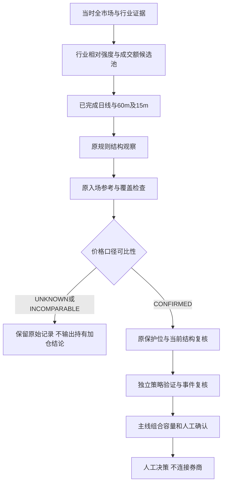

# 波段规则依据、可比性与独立验证规格

范围：SW-RESEARCH-AND-COMPARABILITY；基线 `c2cbd384bfab542530b6bcdca01f447b0b1f8db8`。
本文固定现有规则的解释及下一验证设计，不是新策略批准、回测收益报告或第二份执行台账。
永久 `action=no_order`；策略状态 `NOT_PROVEN`。没有通过调整阈值、样本或成本产生交易。

## 1. 核心判断

现有方法是“行业活跃度筛选 + 多周期突破/回踩结构”的**本项目研究假说**，不是已经验证的行业标准策略。
它试图捕捉信息渐进扩散与趋势延续，但也可能只是追逐短期噪声、拥挤交易和涨停后的不可成交价格。
适用研究范围为当前适配器支持的沪深 A 股普通多头观察；不能自动推广至北交所、港股、期货或做空。
预期持有数个交易日至趋势失效，但当前代码没有固定最大持有日或已验证平均持有期，不能宣传确定收益周期。
高频震荡、除权、流动性收缩、行业映射错误、跳空、停牌和拥挤反转均可能使方法失效。

## 2. 有界来源审查

| 来源 | 固定版本/定位 | 采用范围与差异 |
| --- | --- | --- |
| [Moskowitz/Ooi/Pedersen 作者研究页](https://www.aqr.com/Insights/Research/Journal-Article/Time-Series-Momentum) | 2012 年研究；58 个期货/远期合约，主要使用过去 12 个月回报 | 只支持调查趋势假说。不是 A 股个股 60 分钟、五根窗口、1.2 倍量能或缩量回踩的直接验证。不能继承其收益结论。 |
| [Backtrader Donchian 说明](https://backtrader.com/recipes/indicators/donchian/donchian/) | 说明页的前移窗口；固定库源码 [basicops.py](https://github.com/mementum/backtrader/blob/b853d7c90b6721476eb5a5ea3135224e33db1f14/backtrader/indicators/basicops.py)，`Highest/Lowest/OperationN` | 参考“只用此前窗口极值”的可复算实现，不复制代码。其指标不构成当前五根/量能/回踩组合的经济证明。 |
| [Backtrader 执行模拟](https://github.com/mementum/backtrader/blob/b853d7c90b6721476eb5a5ea3135224e33db1f14/backtrader/brokers/bbroker.py) | `BackBroker._try_exec_market`，commit `b853d7c90b6721476eb5a5ea3135224e33db1f14`，1.9.78.123，提交日期 2023-04-19 | 参考信号与下一 bar 执行分离；不采用默认撮合为 A 股可成交证明。库为 [GPL-3.0](https://github.com/mementum/backtrader/blob/b853d7c90b6721476eb5a5ea3135224e33db1f14/LICENSE)，本包不复制、不安装、不集成。历史版本年龄不等于失效，也不等于持续维护保证。 |
| [AKShare 新浪适配](https://github.com/akfamily/akshare/blob/fe10d1decb705e5f43cc8ca3339ca39e580fb8f4/akshare/stock/stock_zh_a_sina.py) | `stock_zh_a_daily/stock_zh_a_minute`，commit `fe10d1decb705e5f43cc8ca3339ca39e580fb8f4`；[MIT](https://github.com/akfamily/akshare/blob/fe10d1decb705e5f43cc8ca3339ca39e580fb8f4/LICENSE) | 仅数据接口参考。源码依赖 pandas、requests、JS 解码运行时；本包不新增这些依赖，不复制动态求值。分钟与复权因子接口没有历史全事件覆盖保证，不能把今天取得的复权因子当过去已知数据。 |

以上 GitHub HEAD 在 2026-10-23 经 `git ls-remote` 固定；核对固定版本源码和许可证，而非只读 README。
本包未运行上游项目测试，不能宣称兼容其全部行为；本仓库使用自己的 Decimal、来源绑定、交易日和拒绝机制。
选择唯一复现基线：**保留当前规则，不新增替代策略**。Donchian 仅作极值窗口计算参照；不引入 Qlib/Backtrader 全框架。
此前 TradingAgents 等参考继续遵守 `open-source-code-borrowing-review-20261009.md`；模型辩论不能批准交易。

## 3. 已实现规则的准确规格

路径前缀 `src/value_investment_agent/`。下列阈值是继承的研究参数，不是本次论证后批准的最佳参数。

| 环节 | 实际规则/代码 | 证据与状态 |
| --- | --- | --- |
| 候选发现 | `domain/hotspot/daily_selection.py:rank_daily_candidates`，v3；行业等权涨跌幅减覆盖市场均值，按相对强度、成交金额、代码排序；行业轮询每行业最多 2 个，池上限 30 | 描述活跃度，不代表行业指数收益、真实资金流或催化剂。行业历史成分 PIT 缺失时不能生成无偏历史池。 |
| 原始输入 | 已完成 daily/60m/15m OHLCV；价格元、成交金额人民币元，量比为同来源无量纲比；保留来源量单位，不混接跨来源量能 | daily 由完整分钟 bar 聚合，不从 daily 伪造 minute；必须保留原件、Hash、抓取/可得日期与交易时点。 |
| 开仓结构 | `price_action_plan.py:calculate_price_levels`，`hotspot-prior-five-completed-bars-v1`；至少 6 根；最新收盘严格大于前 5 根最高价，最新量至少为前 5 根均量的 1.2 倍 | 排除当前 bar 的窗口计算可复现；5 和 1.2 没有直接适用性证据，仍待独立检验。只是 ENTRY_OBSERVATION，不是批准买入。 |
| 日线结构 | `confirmed_price_structure.py:confirmed_swings`；拐点严格高/低于左右各 2 根；右侧第二根完成后才 known_at；最近两个高点和低点同时上移/下移定义趋势 | 不可把 pivot_at 当 known_at。相等高低点不算新极值。两侧 2 根参数是自定义研究假说。 |
| 确认与机会分级 | 同模块 `analyze_price_behavior` 与 `opportunity_quality.py:classify_structure`；下一完整 bar 仍高于此前突破位；daily/60m/15m 冲突分别保留 | 15m 仅辅助。行为质量和机会分级是不同合同，不合并成一个可交易分数。 |
| 加仓结构 | `RETEST_LOOKBACK=10`：已观察突破后，中间收盘不低于突破位；至少一次 low 触及且量小于突破量；最新完整 60m 收盘超过前根 high 和突破位、量比至少 1.2 | 当前索引从 `max(5,len(rows)-11)` 至 `len(rows)-3`，不是“过去十天”。不得因为价格下跌就加仓。数值/窗口组合仍未独立验证。 |
| 减仓结构 | 已确认日线高低点下移，或已确认上方阻力与保护位形成的结构距离比不大于 1 | 距离比不是收益预测、胜率或净收益；没有阻力时为未知，不填目标价。无减仓数量输出。 |
| 退出结构 | 当前完整 60m 收盘严格低于前 5 根最低价；有原入场参考时另外冻结原保护位，检查入场后每根完整 bar 的首次破位 | 反弹/降低滚动保护位不会抹除旧破位。既有保护价不是保证成交的止损价。 |
| 持仓连续性 | `application/hotspot/lifecycle_review.py` v2 | 缺区间、入场证据、规则一致性或价格可比性时 UNKNOWN。保留原始未复权结构记录，但不把它当 HOLD/ADD/EXIT 准入。 |
| 仓位/动作 | 交由主线共享组合与独立准入；本分支不生成个人股数、金额或订单 | 不使用价值 G3 代替波段独立验证，不绕过事件、同股风险、现金、T+1 与可卖数量。 |

## 4. 公司行动口径的真实能力

交易所说明现金分配、送转/配股可改变除权参考基准；参考价也不是实际成交价。
参见[深交所说明](https://www.szse.cn/www/investor/knowledge/t20181017_555756.html)及
[证监会解释](https://www.csrc.gov.cn/csrc/c100028/c1002481/content.shtml)。本包不实施除权公式或改写历史价格。

复用 `infrastructure/evidence/historical_distribution_correspondence.py` 和 `docs/reviewed-cash-distributions.json`，
再次核对登记条款、原 PDF Hash、URL、页码、登记日/除息日/付款日顺序和每股金额算术。
原合同明确 `complete_historical_coverage_proven=false`、`historical_availability_proven=false`；本包不把这两个轴升级。

- `INCOMPARABLE`：已核对的收录实施事件除息日在价格形成窗口内；直接比较未复权价有已知断点，原保护价不自动折算。
- `UNKNOWN`：资料不存在、失效、晚于评估截止，或事件登记覆盖不全。没有事件不是完整的“无公司行动”证明。
- `CONFIRMED`：领域合同要求完整同口径覆盖；**当前收录分红适配器不能签发这一状态**。合成完整覆盖只测试领域分支，不是实际覆盖凭证。
- 价格窗口包括原始及当前 case 的实际形成窗口，不仅从入场日开始，避免忽略形成保护位之前的除权。
- 即使登记与原文对应，也不重新声称 PDF 语义审阅、独立历史 PIT、配股/拆并股全覆盖、税费或可卖数量已通过。

输入新增可选 `corporate_action_registry_binding={path,sha256,available_at}`；`available_at` 是调用方提供的取得记录，
不能替代独立归档 PIT 证明。禁止提供无日期/未来日期，禁止使用文件修改时间当取得日。
输出 `price_comparability`、`unadjusted_structural_observation` 与解释路径中的 `PRICE_COMPARABILITY`。
现有完整真实范围审查仍缺：除现金分配外的送转、配股、拆并股及修订/取消对应，和窗口内完整覆盖的来源验证。
这是具体未完成数据/验证依赖，不是修改成 PASS 的理由；本次不声称已完成全部公司行动准入。



## 5. 验证规格及停止条件

复用 `selection_history.py`、`strategy_execution_replay.py`、`quantitative_validation.py` 和
`independent_validation.py:REQUIRED_ADMISSION_CHECKS`，不另建验证器平台。本节是固定研究设计，
**不是已注册/已执行的 OOS 协议**；将来运行前必须由现有协议绑定实际起止日、数据/规则/成本 Hash。

1. 冻结当前基线、候选池规则、信号和退出参数；收益输出不得反向修改 5、1.2、2、10 或距离比阈值。
2. 历史 development 数据仅用于实现/数据诊断；不能将已看过的 Oct14–22 或五个条件样本划为 untouched OOS。
3. 候选池使用当时全体可获得证券和行业分类，保留退市、停牌、无成交及失败样本；没有当时分类时该窗口拒绝独立选股结论。
4. 下一独立研究窗口拟用 126 个完整交易日，分 3 个不重叠 42 日块。该窗口只是待独立研究审查的设计，不是工期或盈利承诺。
   每块之前至少保留规则所需形成数据；观察基线不拟合参数。登记必须早于第一块，禁止回填；既有持仓与边界未平仓明确带入或右删失，不凭空清仓。
5. 参考基准固定为现金及同日同覆盖池等权持有；市场指数作另列对照，不能将不同样本/暴露直接作超额收益。
6. 信号在完整 bar 与所有依赖 available_at 之后；假想执行只能在之后合法交易时点。未知停牌、ST/上市状态、限价、可卖数量、费用/成交量时严格拒绝成交。
   手续费、税费、过户、滑点、最小交易单位的适用证券和生效日期必须先由官方/账户依据确定；不将旧常量当最新标准。
7. 报告基础及 0x/2x 费用敏感性、净回报、同成交毛回报、最大回撤、换手、暴露、交易数、拒绝率、逐块表现和未平仓情况。
   已有模拟器只支持部分执行语义，不能用“冻结订单可模拟”替代整个选股/加减仓策略 OOS。
8. 证据验收为零已知未来函数/伪造状态、费用对账、完整事件口径、未污染划分和可复现结果；任一不满足即不准入。
   经济验收须由独立研究者预先确定与用户风险预算相符的基准/不确定性标准；当前没有获批收益或回撤门槛，不能临时选一个能通过的数。
9. 数据不足或交易数不足只报不足；零入选可合法，但资料缺失不能解释成零机会。真实 Shadow 按自然时间累计，不由回放次数替代。
10. 独立研究审查、用户固定版本确认及共享组合准入均保留。本文提交/测试全绿不会自动满足这些门禁。

## 6. 当前真实边界与交接

继承已审证据：Oct14–22 历史选股仅 3/7 完整，PARTIAL；Oct22 十个来源绑定案例未提供 owned Entry。
本包针对来源绑定分配事件运行真实原件对应检查；跨除息窗口可发出不可比警示，不能据此声称完成持仓收益或成交验证。
实际固定三家公司 600519/000333/601088 的最近已收录分配窗口均为 INCOMPARABLE；
它们的 Oct21–22 窗口均为 UNKNOWN，而不是“已证明没有公司行动”。
Oct22 案例中能在各自历史截止前重新核验前序参考的 300750/601318 已走完整解释链，
可比性仍 UNKNOWN；这些是公开参考 case 的比较，不是真实买入记录，也没有使用私人账户。
原始破位、反弹、缺日、伪造 Hash、未来日期和真假覆盖标记使用 TEST_ONLY 夹具验证，不冒充真实持仓。
共享 API/Web/组合/CI、独立审查和正式发布由主会话整合；本分支不更改 8001、Canonical Excel、私人账户或服务器。
最终提交及精确测试/真实来源回执由本包交付说明提供，不重复改写唯一执行台账。

## 7. 官方窗口覆盖接入与独立验证准备

本节为 `SW-COVERAGE-AND-VALIDATION-READINESS` 的代码与真实原件复核结果，继承
`cca1ef97`，不更改信号参数、策略准入或共享发布。只读复用
`application/product/daily_event_observation.py:verify_retained_event_coverage`；未修改该共享模块。

新增 `application/hotspot/corporate_action_coverage.py:inspect_official_action_coverage`：

```python
inspect_official_action_coverage(
    root=public_archive_root, symbol="600519", start=formation_start,
    end=formation_end, now=aware_cutoff,
    observation_binding={"path": relative_observation_path, "sha256": expected_hash},
)
```

实际链路为已有官方全量查询采集器（`retain_raw_index=True`）→ 原始分页响应/请求元数据与
PDF 归档 → 原生覆盖核验 → 波段价格形成窗口匹配 → 待审公司行动清单。
新增接口只读，既不重新联网也不生成扫描“完整”标记。查询可覆盖更宽窗口，但不能少于原始与当前
参考 case 的全部形成期；未闭合自然日的扫描不能冒充全天完整。
原生核验逐项检查证券、orgId、非关键词过滤、分页数量/顺序、实际原始字节、Hash、公告集合与 PDF。
本地 Hash 证明归档一致性，不是外部公证、服务器签名或独立历史时间戳。

输出严格分轴：

| 字段 | 含义与可达状态 |
| --- | --- |
| `official_publication_coverage` | `COMPLETE` / `PARTIAL` / `MISSING` / `INVALID_OR_UNAVAILABLE`；只指查询原件及其发布日期范围 |
| `corporate_action_coverage` / `price_comparability` | 本接口均维持 `UNKNOWN`，不能覆盖分配登记适配器已确认的 `INCOMPARABLE` |
| `pending_announcements` | 每份公告均保留 ID、标题、来源、发布日期和原件绑定，等待正文及生效条款审查；标题无关键词不能豁免 |
| `action_family_coverage` | 现金、送转、配股、拆并股、吸收合并/股份转换、修订取消逐类 `UNKNOWN`，不能默认为无事件 |
| `opening_pending_actions_verified` | `false`：窗口前已公告、窗口内才生效的行动还缺期初状态 |
| `historical_availability_proven` | `false`：归档取得时点不回填为公告发布时间，也不自动证明独立 PIT |

生命周期新增可选参数 `official_event_observation_binding={path, sha256}`；在原始参考与当前行情均通过
核验后，将结果放在 `price_comparability.official_disclosure_coverage`。不改变原保护价、原始破位记录、
既有可比性拒绝和 `action=no_order`。缺少 owned Entry 仍不生成个人持仓操作。
中文报告把公告查询完整与价格口径完整分开解释；没有归档时公告数量显示未知，而不是 0。

### 真实归档复核

2026-10-23 只读核验已有两份 `runtime/incremental-validity/{symbol}/goal-20261023-completed-window/`
归档，扫描范围均为 2026-10-11 至 2026-10-22：

- 600519：0 条公告，原始查询覆盖通过；600887：3 条公告，原始查询和 PDF 覆盖通过，三份正文仍待语义审查。
- 两者均不能证明期初待生效行动、实施条款及修订取消链完整，故不是同口径确认。
- 将所需价格形成期扩到 2026-09-01 时，输出 `PARTIAL`，不偷偷缩短保护位形成期。
- 在 2026-10-22 23:59:59 截止复核这两份次日取得的原件时，输出 `INVALID_OR_UNAVAILABLE`。
- 实际历史公开参考 300750、601318 的原保护位分别为 280.230、50.850，当前滚动保护位分别为
  218.450、50.240；原始首次破位记录均保留，但价格口径未证明可比。这些数字仅解释历史参考计算，
  不是今天的保护价、真实入场或个人卖出提示。对应证券尚无本包绑定的完整官方行动扫描。
- **没有宣称真实行情参考与完整同口径证明已端到端通过**。600519 的原生完整扫描与保护位串联使用
  明确的 TEST_ONLY 原始响应和时钟夹具，验证完整公告查询仍不能抹除原保护价或放行机械退出。

### 可取得资料与独立样本缺口

再次运行现有 `validate_current_hotspot_strategy` 和 `replay_selection_history`，没有新建策略验证平台：

| 资料 | 本次真实结果 | 可用范围 / 下一依赖 |
| --- | --- | --- |
| Oct14–22 候选池/行情原件 | 7 个交易日仅 3 个可完整复算；Oct19 缺失，Oct14/20/21 不完整 | 可诊断覆盖；已看过的数据不能重新命名 untouched OOS |
| 既有五公司 Apr13–Oct15 历史条件样本 | 协议 Oct16 登记，验证段从 Jul1 开始；159/159 信号所用归档晚于决策时点 | 回放而非独立样本外；不能回填登记日或取得日 |
| 严格执行路径 | 159 次因 `MISSING_DATED_STOCK_STATUS` 拒绝 | 需要对应当日停牌、ST/上市、限价与成交约束原件，不伪造“正常交易” |
| 成本复算 | 0x/1x/2x 算术通过 | 不证明真实费率、滑点、可成交性或盈利；成本依据仍不足 |
| 当前候选池原件 | 原件核验通过；Oct22 在本次 Oct23 评估时为 `STALE` | 完整性通过与当前可用分开，不把旧结构报告当新候选准入 |
| 官方公告完整窗口 | 600519/600887 范围内原件可核验 | 仍缺期初行动、实施条款、修订取消与统一价基映射；不能自动输出 CONFIRMED |
| 未污染独立历史段 / 真实 Shadow | 本次未发现可证明的 untouched OOS；不检查或制造 Shadow 日志 | 协议与经济门槛须先固定，再收取未使用窗口的当时数据；本报告新增自然时段信用为 0 |

公开历史数据可用于补充原件与规则诊断，但“今天下载到过去 K 线”不等于已有当时取得链；
独立归档来源须证明原始可得性、当时证券/行业池和修订历史，不能仅靠文件 mtime。
前瞻留存须沿现有采集接口，先绑定固定规则、成本、候选全集、区间与准入标准，再积累资料；
本包不启动定时任务、不注册伪历史协议，也不把拟定的 126 日设计视为已批准/已执行的验证。

剩余明确依赖为：公司行动语义与期初状态审阅、同价基证据合同、当时全市场/行业与可交易状态、
固定且独立的未污染验证窗口及真实 Shadow。它们阻止策略正式准入，不阻止其他已授权工程。

## 8. 一项真实现金实施事件的具体价格映射

后续有界工作包继承 `bfceddd8`，复用原分配登记对应核验、原 PDF 校验、PDFium 提取以及
`extract_distribution_dates`；不修改冻结登记，不将旧函数改造成另一套交易引擎。

本次选择 600519 的[2025 年中期权益分派实施公告](https://static.cninfo.com.cn/finalpage/2025-12-11/1224867074.PDF)：
公告编号临 2025-053，登记日 2025-12-18，除息日及公告付款日 2025-12-19，每股税前现金 23.957 元。
第 1 页明确非差异化；第 2 页完整现金方案的股数、每股金额及总额可复算；读取全部 4 页以定位日期和正文。
公告金额不是税后实际到账金额，已过付款日也不证明某私人账户收到了现金。

新接口 `application/hotspot/cash_event_mapping.py:build_cash_event_mapping` 输入事件登记 Hash/取得时间、
记录日、两端价基日期和**仅解释用途的参考价**。输出事件原文核验与单事件坐标计算并列：

- `infrastructure/hotspot/cash_implementation.py` 仅支持可完整匹配的非差异化、纯现金实施方案，
  校验首部每股现金、完整分配段、总额舍入、正文日期与登记一致；返回具体条款页码、读取页码、原件 Hash。
- 不支持差异化、非现金、未知布局、未来生效、原件/登记冲突；非现金不会因登记遗漏字段被默认成零。
- 可输入 Hash 绑定的相关公告；遇到修订、更正、取消或撤销原文时为 `PENDING_LINKAGE`，**不输出换算**。
  这只是保守的“需要链接核验”，不是自动认定该事件已取消，更不是完整修订链验证器。
  无相关公告输入或未见这些文字仅为 `ABSENCE_NOT_PROVEN`，不能声称无修订。
- `domain/hotspot/cash_price_mapping.py` 仅在 `原价基日期 < 除息日 <= 当期价基日期` 时应用一次现金调整，
  原保护位和原当期价不变；原价基本来已在除息日或之后时不重复扣除。

计算依据是[交易所现金除息参考公式](https://www.szse.cn/www/investor/knowledge/t20181017_555756.html)
在无股份变动条件下的现金部分；[证监会解释](https://www.csrc.gov.cn/csrc/c100028/c1002481/content.shtml)
也明确参考价不等于实际成交价。把同一现金平移用于历史保护参考线是本项目的**条件性坐标解释**，
不是交易所批准的止损策略。未实施最小报价单位取整，不输出可下单价格，不计算股息税或总回报。

可复算示例：**1500 和 1480 都是模拟参考价，不是该日真实行情或用户入场价**。
仅考虑这次现金事件：原保护参考坐标 `1500 - 23.957 = 1476.043`；当期参考价还原为
`1480 + 23.957 = 1503.957`。原始价差为 -20，单事件换算后价差为 3.957。
这说明单看未处理公司行动的“跌破原价”可能混淆价格口径，**不能据此认定实际没有破位或应持有/加仓**。

正向状态为 `CONDITIONAL_SINGLE_EVENT_MAPPING`，不是又一层空 UNKNOWN；但窗口可比性仍为 UNKNOWN：
本包未证明原保护位整个形成期内没有其他公司行动，也未完成期初待生效事项和后续修订取消全链。
没有修改生命周期已批准保护位、策略阈值、Web 或账户；没有生成 owned Entry、OOS 或真实 Shadow。
正式同口径确认仍须独立完整窗口证明，调用者不能用 `complete=true` 字段放行。
中文输出 `render_cash_event_mapping_markdown` 保留原价、参考换算、依据页码和未完成项，供主会话整合。

## 9. 法定费用原件对应补齐

本有界包继承 `50a01b30`，选择补齐 `EXECUTABLE_COST_BASIS` 中一项具体来源缺口，而非另建验证框架。
再次用固定历史规格复算 Oct14–22，仍为 3/7；未补齐候选行情不回填为当时已知。
当前目录已有 Oct23 新指针，旧可选真实测试用 Oct23 05:00 UTC 截止读取该新指针会失败，
在未改的 `50a01b30` 也已复现；它与本包费用改动无关，不能改写当前指针来让历史测试通过。
随后按主会话授权，将这项热点测试绑定到原 Oct22 的候选池及十个行情 case 的明确 Hash，
继续运行原生来源/PIT 验证；另测早于取得时间的截止仍被拒绝。不修改 current 指针或历史时间。
显式输入时 `registry_binding=null` 如实表示未使用可变注册表，不生成虚构注册表绑定。

现有 `strategy_execution_replay.py` 的过户费链接与已归档正确通知不同。本包修正为
`historical_fees.SOURCES['transfer-2022']`，并复用 `runtime/trading-rule-evidence/20260908T115226080339Z`
已有三份原件和 manifest：2008 年单边印花税、2023 年印花税减半、2022 年股票交易过户费调整。
三份原件固定 Hash 继承已有研究代码和冻结费用说明；不修改该历史组件、原件或冻结说明。

`infrastructure/hotspot/statutory_fee_evidence.py` 只读核对唯一 source_id、请求和最终官方 URL、
路径、字节 Hash、取得时间及正文条款，拒绝维护页、重定向替代、重复来源、未来日期与重新填写的 Hash。
本次中国结算通知在线访问超时，实际复核依据是已有归档原文，不声称重新成功抓取了在线通知。
已复核的[财政部原始单边通知](https://www.mof.gov.cn/zhengwuxinxi/caizhengxinwen/200809/t20080919_76432.htm)
和[减半公告](https://www.mof.gov.cn/jrttts/202308/t20230828_3904235.htm)仍分别保留生效日期与买卖方向。

正向结果为 `VERIFIED_RETAINED_OFFICIAL_NOTICES`，既有回放增加 `statutory_fee_evidence` 与实际实现 Hash。
独立验证新增 `STATUTORY_FEE_NOTICE_CORRESPONDENCE`，只表示原件对应、回放声明费率一致。
完整 `EXECUTABLE_COST_BASIS` 仍为 `INSUFFICIENT_DATA`，原有正式准入检查集合不变。
未取得原件的验证根目录为 MISSING/INVALID，不默认零成本，也不阻断已有假设回放。

复用 `historical_fees.statutory_components` 在其原有 2015–2025 范围内做未舍入算术检查：
10 万元成交额在 2023-08-25 卖出对应印花税 100、过户费 1；2023-08-28 卖出为 50 和 1，
同日买入为 0 和 1。示例不是实际成交，日期是成交日；未把公告日期或信号日期用作成交日期。
回放的佣金、最低收费、滑点与税费**数值均未修改**，真实留存回放计数摘要与上一回执一致。

仍未证明 2026 年全部费用政策连续性、个人佣金内含项目、分笔与到账舍入、实际成交价格、
流动性与可卖数量。历史归档取得时间不变，不构成新的独立 PIT/OOS 或真实 Shadow。
本包只是把一项真实法定费用来源缺口落到可复算原件；策略保持 NOT_PROVEN，永久 `action=no_order`。

## 10. 实施原文与官方后续公告窗口联查

`corporate_action_coverage.inspect_cash_action_window` 复用全量原始响应核验和现金实施条款核验，
要求查询覆盖价格形成期及实施公告发布日起的区间，并将索引中的全部其他 PDF 自动送入后续公告核验，
不按标题关键词预先剔除。`IMPLEMENTATION_AND_PUBLICATION_WINDOW_BOUND` 表示这一事件及查询原件对应，
`REVISION_REVIEW_REQUIRED` 表示发现需要链接审阅的更正/修订/取消/撤销原文；后者阻断参考坐标换算。
原件冲突、缺失、窗口过短、实施原文未在索引中、未来取得或不可读的其他原件都不放行。

`build_cash_event_mapping` 新增可选 `official_event_observation_binding`，把自动窗口核验放入
`event_window_review`；生命周期在同时提供官方窗口和分配登记绑定时，为跨界现金事件输出
`price_comparability.cash_action_window_reviews`，保留原价、原保护位、原始破位记录与原准入状态。

真实查询 600519 的 2025-12-11 至 2025-12-19 官方全量窗口得到一份实施公告，复用了原有同 Hash PDF，
新封存原始分页响应与请求元数据。实际近期零公告窗口无法覆盖这份较早的实施公告发布日；
扩展价格形成期超出封存查询范围也被拒绝。新取得时间保留为实际 2026-10-23，不回填历史 PIT。
即使只查到实施原文，仍未证明完整期初公司行动状态或修订语义不存在：`no_change=null`、
`comparison_allowed=false`、`price_comparability=UNKNOWN`。单事件条件算术不升级为整体可比性。

## 11. 显式更正/撤销关联的有界语义合同

继承 `2c59cbb9`；新增热点 domain/adapter 读取原文，既有覆盖结果增加 `lineage_review`，沿用官方
observation 绑定输入，不改变共享 API 签名。只有同证券、原公告编号/标题/发布日期显式对应且日期
不矛盾才为 `EXPLICIT_TARGET_MATCH`。缺目标、多目标、目标不一致或来源不可用都不猜测关联。
`CORRECTION_DECLARED` 要求明确更正前后陈述；`CANCELLATION_DECLARED` 要求明确执行性撤销句及
相应标题。否定、条件、引用旧话和传闻澄清不能当作执行撤销；混合陈述保留待审。
这是一份文件对原事项的陈述，不是完整修订链、实际权益到账或整体价格基准已通过。

真实 301061 官方 2025-05-20—21 窗口封存两份 PDF：
[原公告2025-021](https://static.cninfo.com.cn/finalpage/2025-05-20/1223587288.PDF)，
SHA256 `21c88b5d82b63af92c096a935c989c625fb1d54e8295a51c6c39710f8a839a8a`；
[更正公告2025-022](https://static.cninfo.com.cn/finalpage/2025-05-20/1223605477.PDF)，
SHA256 `b4b8b6ddbf251ac00596879dd8857896f8a46acb4951e729b03248d15e89dc2c`。
更正明确指向原公告及“七、股份变动情况表”，不能当作取消整个分配方案；原公告含非现金转增，
现金单事件公式不替代该方案核验。文件实际取得时间为 2026-10-24 上海时间，不回填为2025年已取得。

生命周期沿用既有官方输入展示该关联，价格形成窗口不足仍为 PARTIAL，整体可比性仍 UNKNOWN。
真实公开行情仅使用周末最近收盘展示合同，`current_pit=false`；没有创建 owned Entry 或持仓。
剩余为完整期初行动状态、多级修订链、未支持格式与非现金模型、独立历史 PIT 和正式账户事实核对。
