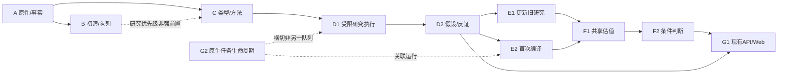

# VALUE-MAINLINE-P0：真实基线、接口冻结与阶段1

审计观察日：2026-11-01。源码基线：283c7212d832f52118705bb095e046e0c36dcbfc。
这是本期审计报告，不是新 Goal。最新用户指令优先：仅 CORE_VALUE；热点保留、暂停新增。action=no_order。
本期新增代码、最后提交、隔离验证和运行中版本须分别以交付回执核实；本报告不能充当发布证明。

## 1. 真实版本与整合判断

| 层次 | 已核实状态 | 处理 |
| --- | --- | --- |
| 工作树 | D:/GPTProject/value-investment/.tmp/vf1；codex/value-f1-e1-g1-20261027；基线283c7212 | 沿用，不reset/clean/覆盖 |
| 原有未提交内容 | config/current-research-drafts.json；SHA256 2aba22a9e043d20076c7c40916808aee1bae9ba48f13951b8d0735e6fa077686 | 受保护，不纳入本期提交 |
| 本地main | 3e6c5b410ed4acb5ea92806c0caa15d2be86dcee | 不是最新远程main |
| origin/main | 73605c7ae6de11e949f6d0d379372147c257c4ed | 与HEAD分叉；main独有README提交，不能强推覆盖 |
| PR1 | 70722814；draft/open；已是HEAD祖先，无独有patch | 不重复cherry-pick；收尾可另行关闭 |
| PR2 | 283c7212；open；目标main；相对当前main约1963路径变更 | 作为现有集成PR；标题不代表真实范围；不自动合并main |
| PR3 | 8a9b5fd1；draft/open；目标当前分支；12路径未整合 | 新ProjectControl与现有/project路由/状态重复；只选择有用内容，不整包盲合 |
| 母公司义务分支 | 12f12207为HEAD祖先 | 已整合，不重复开发 |
| 热点sw1 | 011db17d未是HEAD祖先，仍有独有成果 | 保留分支和证据，不纳入本次价值整合 |
| 本机8001 | 本期修改前API报告backend/frontend均283c7212 | 本轮禁止发布，不能把本期源码称为已上线 |
| 当前持久化 | Web有runtime/native artifacts和默认内存repository；未发现生产Pg实例构造证据 | PostgreSQL实际运行版本NOT_VERIFIED；不读取凭证、不查询生产库 |

[54条本地/远程ref及差异路径原始快照](../../../artifacts/current/value-mainline-p0-20261101/baseline.json)。
PR API的base SHA/mergeable可能早于本次fetch；实际祖先关系以本地Git验证为准。

基线GitHub原始运行：Core 41285690588、Web 41285690600均success；
PR1 Core40299413327/Web40299413468；PR3 Core40671600763/Web40671600645均success。
这些只证明各自SHA的CI，不证明本期新增代码、生产数据、经济充分性或部署。
8001既有整体PUBLICATION_REGISTRY_UNAVAILABLE、报价新鲜度UNVERIFIED不得隐藏。

## 2. 11模块真实能力矩阵

唯一机器能力目录：[value-mainline-modules-v1.json](../../../config/value-mainline-modules-v1.json)。
每模块列出12项审计证据、原生输入输出、8方法状态、真实样本、拒绝及隐式默认边界。
目录记录审计能力，不存实时任务状态；工程、业务、用户验收分轴。原生入口存在不等于统一wrapper已完成。

详细取证：
- [A/B/C/E1/E2](abc-e-audit.md)
- [D1/G2](d1-g2-audit.md)
- [D2/F1/F2](d2-f-audit.md)
- [G1/Web](g1-web-audit.md)

关键判定：
- A官方来源及有限字段闭环真实存在；不是完整财务事实库。本期补通原生绑定闭包的归档/隔离恢复。
- B预算不得覆盖来源冲突已实现并有4项回归实测，不重修。当前有限覆盖/历史快照不等于全市场当日成功。
- C固定五家适用性冻结，不是通用分类器；000568 E2不能倒填为C新增验收。
- D1/G2已有锁、预算、取消、恢复及结构化持久记录；不再新建任务系统。
- D2/F1两公司条件研究、000568首次编译真实存在；条件计算不等于经济采用。
- F2决定性缺口仍是确切经济候选及股本/分配/重大事件/新财务/合格报价对齐，不是缺估值引擎。
- G1已有研究消费者，但/project工程快照与实际运行须严格分开。

## 3. 依赖图

E1/E2是进入F1的替代路径，不是双重强前置。真实历史Artifact可满足上游合同；不能把Fixture升级为真实全链验收。
G2运行成功与G3/价格资格/个人授权不同；公开研究不依赖私人账户。

## 4. ModuleRun与接口冻结

[统一JSON Schema](../../../schemas/value-mainline-v1.json)规定ModuleRun与11模块包装层输入输出；
各模块原生事实、PIT、金额、范围校验仍必须执行，不能仅通过通用JSON Schema验收金融输入。

ModuleRun包含run_id/module_id/symbol/run_type/status、起止时刻、输入输出清单、来源、模型/规则/提交、
父运行、阶段事件、警告/错误、指标与Artifact。清单SHA绑定规范化内容，来源/输出分别绑定原件。
新验证产生新的VALIDATE记录，不能把历史任务时间、旧模型调用或缺失的提交身份补造成当前真实运行。
验证成功只说明明确范围内的来源/合同有效，绝不授予投资资格。

8接口是validate/run/get_run/replay/explain/health_check和input_schema/output_schema。
机器目录分别标注EXISTING_NATIVE/PARTIAL/DESIGN_ONLY。本期A/B实际连接，其余沿用原生能力和冻结设计，
不谎称所有11模块已统一可执行。历史、比较、重试复用原生任务/Artifact引用；没有新数据库、队列或日志业务状态。

唯一CLI目录仍为config/current-cli-entrypoints-v2.json，v1兼容指纹保持。
批量执行必须受原生预算、样本及适用范围约束；Schema的存在不授予全市场运行权限或证明全覆盖。

## 5. Web展示与路由

继续使用/strategy/value；/project兼容入口。11主节点与5共享能力分组，不创建PR3的第二项目状态平台。
节点可查看输入/输出合同、依赖、原生入口/只读接口、证据、当前缺口和扩展事项。
人工工程目录不冒充实时运行；尚未连接的目录读取器只能称未接线，不能说D1/G2未实现。
本期仅源码/组件/隔离构建验收，8001仍保持原版本；不以旧页面可访问宣称新页面已发布。

## 6. 阶段1：紧接P0实施A+B

A：现有collect_public_evidence CLI增加archive/restore模式，绑定bundle真实闭包；不扫描拷贝整个目录，
不刷新来源时钟；原件冲突、路径越界或残缺失败关闭，不覆盖现有证据。
真实600519/600887有限事实原件隔离恢复并核对原消费者；不把debt_ratio两字段称完整财报。

B：显式manifest/hash/evaluation_at输入，调用原selector而不改阈值/排序；生成原生selection与不可变ModuleRun，
可独立读取/重放/解释。坏来源不变成空候选；有限覆盖、历史市场、BSE缺口保持PARTIAL。
不重新扫描市场、不暗中调用LLM、不发布current指针、不产生批准。

下一阶段只有在A/B实际回执完成后，沿D1/D2→E1或E2→F1→F2逐段接通。
本轮不增加公司、热点策略、账户、调度、签名、Excel、数据库迁移或生产任务。
